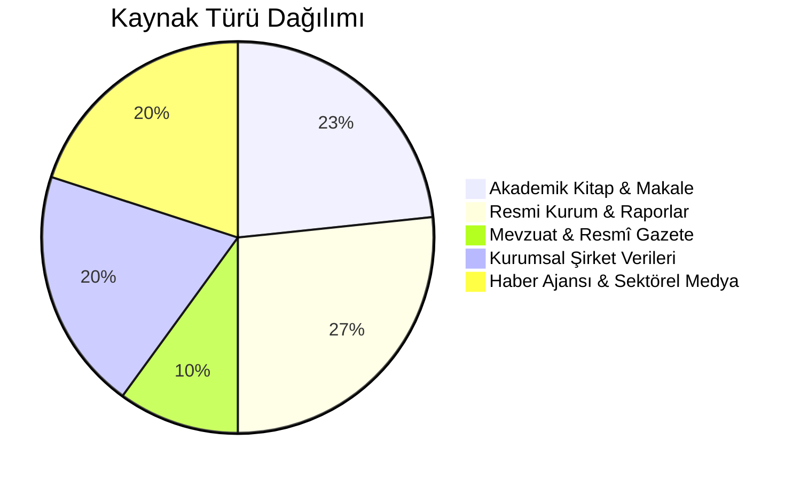

# Mersin Lojistik Tarihi: Kaynakça ve Bibliyografya Kataloğu

Bu doküman, **"Mersin Limanı'nın Tarihsel Gelişimi ve Dönüşüm Evreleri"** çalışmasındaki tüm verilerin dayandığı birincil ve ikincil kaynakları kurumsal, akademik, mevzuat ve sektörel kategorilere ayırarak sunmaktadır.

---

## 1. Kaynak Türü Dağılımı Özeti

---

## 2. Akademik Literatür ve Kitaplar

| # | Yazar / Eser | Yayıncı / Dergi | Yıl | İlgili Konu / Atıf Yapılan Veri | Kaynak Bağlantısı / Not |
| :- | :--- | :--- | :- | :--- | :--- |
| **A1** | **Uğuz, S.** | *Mustafa Kemal Üniversitesi SBE Dergisi*, 13(33) | 2016 | 1870–1912 Mersin Limanında Ticaret, Kırım Savaşı sonrası ihracat | [DergiPark Makale #209024](https://dergipark.org.tr/tr/pub/mkusbed/article/209024) |
| **A2** | **Toksöz, Meltem** | *Brill Publishers* | 2010 | *Nomads, Migrants and Cotton in the Eastern Mediterranean: The Making of the Adana-Mersin Region 1850-1908* (Pamuk ticareti, demiryolu) | ISBN/Brill Arşivi |
| **A3** | **Develi, Şinasi** | *Mersin Tarihi Araştırmaları* | 2001 | *Dünden Bugüne Mersin 1832-2000*, İlk taş iskelelerin kurulumu (1850'ler) | Yerel Tarih Literatürü |
| **A4** | **Mazak, Metin** | *Mersin Deniz Ticaret Odası (MDTO)* | 2013 | *Osmanlı Deniz Ticaretinin Yükselen Değeri Mersin (1812-1922)* | MDTO Yayınları |
| **A5** | **Ateş, A.** | *Çukurova Üniversitesi İİBF Dergisi* | 2013 | "Türkiye'de Liman Özelleştirmeleri: İskenderun Liman Örneği" (Özelleştirme dinamikleri) | Akademik Makale |
| **A6** | **Dergipark Makalesi** | *Sanat ve Tasarım Dergisi* | 2024 | Amerikan İç Savaşı (1861-1865) ve Çukurova pamuğunun yükselişi | [DergiPark Makale #1495000](https://dergipark.org.tr/tr/pub/std/article/1495000) |
| **A7** | **TDV İslâm Ansiklopedisi**| *Türkiye Diyanet Vakfı* | - | "Mersin" Maddesi (1886 Adana-Mersin 67 km Demiryolu açılışı) | [islamansiklopedisi.org.tr/mersin](https://islamansiklopedisi.org.tr/mersin) |
| **A8** | **YÖK Açık Bilim** | *Ulusal Tez Merkezi* | - | Mersin kenti ve limancılık faaliyetlerinin mekânsal gelişimi tez arşivi (1920-1962 kopuşu) | [tez.yok.gov.tr](https://tez.yok.gov.tr) |

---

## 3. Resmi Kurum Belgeleri, Raporlar ve Master Planlar

| # | Kurum Adı | Belge / Rapor Adı | Tarih / Sayı | İlgili Veri / Bilgi | Doğrulama / Erişim URL |
| :- | :--- | :--- | :- | :--- | :--- |
| **R1** | **T.C. Cumhurbaşkanlığı SBB** | *On İkinci Kalkınma Planı (2024-2028)* | Aralık 2023 | Doğu Akdeniz Ana Konteyner Limanı stratejisi ve isimlendirme | [SBB Kalkınma Planı PDF](https://www.sbb.gov.tr/wp-content/uploads/2023/12/On-Ikinci-Kalkinma-Plani_2024-2028_11122023.pdf) |
| **R2** | **T.C. Çukurova Kalkınma Ajansı (ÇKA)** | *2014-2023 Çukurova Bölge Planı* | 2014 | Mersin'in "Doğu Akdeniz Uluslararası Lojistik ve Tedarik Merkezi" ilanı | [cka.org.tr Bölge Planları](https://www.cka.org.tr/bolge-planlari) |
| **R3** | **Karayolları Genel Müdürlüğü (KGM)** | *Otoyol Ağı Gelişim Tarihçesi* | 1993 | O-51 Mersin-Tarsus ve TAG Otoyolu entegrasyonu | [kgm.gov.tr](https://www.kgm.gov.tr) |
| **R4** | **Karayolları Genel Müdürlüğü (KGM)** | *Çeşmeli-Erdemli-Silifke-Taşucu Otoyolu ÇED Raporu* | 2024 | Çeşmeli-Kızkalesi etabı ve batı koridoru yatırımı | [kgm.gov.tr Proje Raporları](https://www.kgm.gov.tr) |
| **R5** | **Ulaştırma ve Altyapı Bakanlığı (SGB)** | *TCDD Lojistik Koordinasyon İcra Kurulu Raporu* | 2023 (Karar: 2023/1-1-e) | Yenice Lojistik Merkezi (531,5M TL, 416.000 m², >1M ton kapasite) | UAB SGB Kayıtları |
| **R6** | **TCDD Taşımacılık A.Ş. & UAB** | *Resmi Sefer Durdurma ve Hat Yenileme Bülteni* | 22 Nisan 2024 | Mersin-Adana tren seferlerinin 24 ay durdurulması, ray sökümü ve YHT hattı | TCDD Taşımacılık Duyuruları |
| **R7** | **T.C. Mersin Valiliği** | *Vali Ali Hamza Pehlivan Kapılar Projesi Açılış Bülteni* | 28 Eylül 2023 | Liman ağır vasıta trafiğini şehirden ayıran otoban bağlantılı Kapılar Projesi | [mersin.gov.tr Kapılar Projesi](https://mersin.gov.tr/vali-ali-hamza-pehlivan-mersin-limani-kapilar-projesi-acilis-torenine-katildi) |
| **R8** | **T.C. Mersin Valiliği** | *Kurumsal Faaliyet Bülteni* | 22 Mart 2021 | 2020 yılı 2 Milyon TEU konteyner rekoru duyurusu | Mersin Valiliği Haber Arşivi |
| **R9** | **Mersin Büyükşehir Belediyesi** | *Belediye Meclisi Gündem Raporu* | 20 Haziran 2025 | Liman Arkası Bölgesi 1. Bölge 1/1000 Uygulama İmar Planı Revizyonu | [mersin.bel.tr Gündem Dokümanı](https://www.mersin.bel.tr/dokumanlar/gundem-20-haziran-2025-841242011) |
| **R10**| **Mersin Büyükşehir Belediyesi** | *Başkan Vahap Seçer Basın Açıklaması* | Temmuz 2024 | Kalkınma planlarında Ana Konteyner Limanı tanım değişiklikleri | [mersin.bel.tr Haber 1721393928](https://www.mersin.bel.tr/haber/baskan-secerden-ana-konteyner-limani-aciklamasi-1721393928) |
| **R11**| **T.C. Özelleştirme İdaresi Başkanlığı (ÖİB)** | *Taşucu Limanı Kısa Tanıtım Dokümanı* | 2018–2019 | SEKA Akdeniz İşletmesi 1984 geçmişi ve özelleştirme sahası | [ÖİB Doküman PDF](https://ms.hmb.gov.tr/uploads/sites/6/2019/03/20180407-Tasucu-Limani-Kisa-tanitim-Dokumani.pdf) |
| **R12**| **Mersin Ticaret ve Sanayi Odası (MTSO)** | *Mersin'in Ekonomik Gelişimi Raporu* | 1998 (s. 97) | 1954-1962 modern liman inşası ve Royal Dutch Harbour Works | MTSO Yayın Arşivi |

---

## 4. Mevzuat, Kanunlar ve Resmî Gazete Kayıtları

| # | Hukuki Dayanak / Belge | Tarih / Sayı | İçerik ve Lojistik Etkisi |
| :- | :--- | :--- | :--- |
| **M1** | **Bakanlar Kurulu Kararı** | 4 Mart 1985 / Sayı: 85/9200 | Mersin Serbest Bölgesi'nin fiziki sınırlarının tespiti |
| **M2** | **3218 Sayılı Serbest Bölgeler Kanunu** | 6 Haziran 1985 | Türkiye'deki serbest bölge rejiminin yasal altyapısının kurulması |
| **M3** | **Bakanlar Kurulu Kararı** | 6 Ağustos 1986 / Sayı: 10877 | MESBAŞ'a serbest bölgenin resmi işletme hakkının devri |
| **M4** | **T.C. Resmî Gazete / TBMM Kanunu** | Ocak 2022 | TCDD özelleştirme sözleşmelerinin +13 yıl uzatılması (MIP bitiş: 2056) |
| **M5** | **Cumhurbaşkanlığı Kamulaştırma Kararı** | Güncel Dönem / Resmî Gazete | TCDD Yeni Taşkent Yük Merkezi projesi için acele kamulaştırma [Mevzuat Takip](https://mevzuattakip.com.tr/mevzuat/yeni-taskent-yuk-merkezi-projesi-kapsaminda-mersin-ili-sinirlari-icerisinde-yer-alan-bazi-tasinmazlar-ile-uzerlerindeki-muhdesatin-turkiye-cumhuriyeti-devlet-demiryollari-isletmesi) |

---

## 5. Kurumsal Şirket Verileri ve Operatör Raporları

| # | Şirket / Kuruluş | Belge / Platform | İlgili Bilgi / Metrik | Doğrulama Bağlantısı |
| :- | :--- | :--- | :--- | :--- |
| **K1** | **Mersin International Port (MIP)** | Destek Portalı (Zendesk) | 28 Eylül 2023 Kapılar Projesi ve yeni kantar düzeni | [MIP Zendesk Duyurusu](https://mipdestek.zendesk.com/hc/tr/articles/10563126703644-Yeni-Kap%C4%B1-Projesi-ve-Kantar-Yerlerinin-De%C4%9Fi%C5%9Fikli%C4%9Fi) |
| **K2** | **PSA International** | Resmi Basın Bülteni (6 Ara 2023) | EMH2 Genişleme Projesi lansmanı ($455M, 2,6M'den 3,6M TEU'ya) | [PSA International EMH2](https://www.globalpsa.com/mip-marks-two-milestones-with-launch-of-emh2-expansion-project-and-port-operator-of-the-year-award/) |
| **K3** | **PSA Euro Med & Americas** | Resmi Basın Bülteni (29 May 2025) | EMH2 Birinci Fazının tamamlanması (880m rıhtım) | [PSA Prezly Duyurusu](https://psa-euro-med-and-psa-americas.prezly.com/mersin-international-port-completes-first-phase-of-east-med-hub-2-terminal) |
| **K4** | **PSA International** | Resmi Basın Bülteni (10 Eki 2025) | EMH2 rıhtımına ilk 400 metrelik mega geminin (*MSC DITTE*, 19.313 TEU) yanaşması | [PSA Mega Vessel Duyurusu](https://www.globalpsa.com/mersin-international-port-welcomes-first-400-meter-mega-vessel-at-newly-completed-emh2-terminal) |
| **K5** | **Akfen Holding** | Yatırımlar Portalı / Liman | 2007 MIP devri ($755M, 36 yıl), 2017 IFM satışı ($869M, %40 pay) | [Akfen Liman İşletmeciliği](https://www.akfen.com.tr/yatirimlar/liman-isletmeciligi/) |
| **K6** | **MESBAŞ** | Kurumsal Tarihçe | 1985–1987 Mersin Serbest Bölgesi kuruluş evreleri | [mesbas.com.tr Tarihçe](https://www.mesbas.com.tr/serbest_bolge/mersin-serbest-bolgesi-7.html) |
| **K7** | **ATAŞ (Anadolu Tasfiyehanesi A.Ş.)** | Kurumsal Web Sitesi | 1958 kuruluş, 1962 rafineri açılışı, 2004 depolama terminaline dönüşüm | [atasterminal.com](https://www.atasterminal.com/) |
| **K8** | **Ceyport Taşucu** | Kurumsal Liman Biyografisi | 1984 SEKA kuruluşu, 2022'de 40 yıllık Ceyport devir teslimi | [ceyporttasucu.com.tr](https://ceyporttasucu.com.tr) |
| **K9** | **MTOSB** | Kurumsal Tarihçe | 1993 kuruluşu, 380 hektarlık 1. etap sanayi-lojistik alanı | [mtosb.org.tr Tarihçe](https://www.mtosb.org.tr/hakkimizda/tarihce) |
| **K10**| **OPET** | Terminaller Bilgi Sayfası | 1998 Mersin Akaryakıt Terminali (240.000 m³ kapasite) | [opet.com.tr](https://www.opet.com.tr) |

---

## 6. Haber Ajansları ve Sektörel Medya Kaynakları

| # | Yayın Organı | Tarih | Başlık / Konu | Kaynak Bağlantısı |
| :- | :--- | :--- | :--- | :--- |
| **H1** | **Anadolu Ajansı (AA)** | 6 Şubat 2023 | İskenderun Limanı'nda depremde devrilen konteynerlerde yangın çıktı | [aa.com.tr Yangın Haberi](https://www.aa.com.tr/tr/gundem/iskenderun-limaninda-depremde-devrilen-konteynerlerde-yangin-cikti/2808588) |
| **H2** | **Anadolu Ajansı (AA)** | 2023 | Depremde zarar gören İskenderun Limanı'nda bir rıhtım daha gemi trafiğine açıldı | [aa.com.tr Rıhtım Haberi](https://www.aa.com.tr/tr/asrin-felaketi/depremde-zarar-goren-iskenderun-limaninda-bir-rihtim-daha-gemi-trafigine-acildi/3044440) |
| **H3** | **Anadolu Ajansı (AA)** | 2024 | Akkuyu NGS'nin Doğu Kargo Terminali'ne 100'üncü kargo gemisi ulaştı | [aa.com.tr 100. Gemi Haberi](https://www.aa.com.tr/tr/ekonomi/akkuyu-ngsnin-dogu-kargo-terminaline-100uncu-kargo-gemisi-ulasti-/3484451) |
| **H4** | **BloombergHT** | 2017 | Akfen Holding'in Mersin Limanı'ndaki %40 payını IFM Investors'a 869 milyon dolara satışı | BloombergHT Arşivi |
| **H5** | **Ports Europe** | 24 Şubat 2022 | DFDS’in *Cappadocia Seaways* Mersin-Trieste Ro-Ro seferi ve HHLA terminali | Ports Europe Arşivi |
| **H6** | **Yetkin Report** | 18 Ocak 2022 | Mersin Limanı ve diğer limanların işletme sözleşmelerinin TBMM kararıyla uzatılması | Yetkin Report Analizi |
| **H7** | **Timeturk** | 16 Temmuz 2012 | Mersin-Trieste ve Mersin-Trablus Ro-Ro hatları (MTSO Şerafettin Aşut açıklamaları) | Timeturk Arşivi |
| **H8** | **Sanayi Gazetesi** | Ağustos 2024 | Çukurova Uluslararası Havalimanı açılışı ve hava kargo lojistiği raporu | Sanayi Gazetesi Arşivi |
